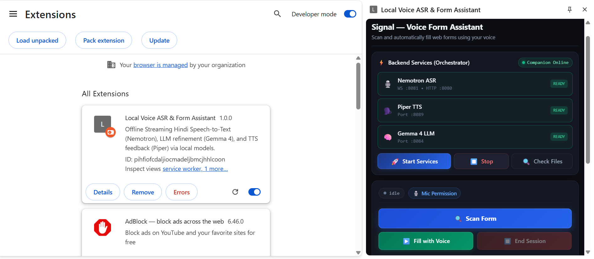
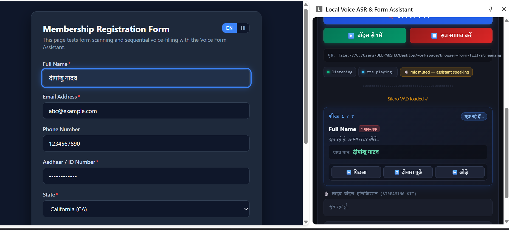

# Streaming ASR & Real-Time Local AI Voice Demos

An end-to-end, high-performance local AI voice interaction suite that runs natively on **Windows, Linux, and macOS**. This project demonstrates real-time streaming Speech-to-Text (ASR), client-side Voice Activity Detection (VAD), Large Language Model (LLM) speech-to-command transformation, and Text-to-Speech (TTS) voice responses across **15 languages**—all operating completely offline.

[](./LICENSE.txt)
[](./extension)
[](https://developer.mozilla.org/en-US/docs/Web/JavaScript)
[](https://nodejs.org/)
[](https://onnxruntime.ai/)
[](#-supported-languages-15-languages--19-locales)

### 🌐 Supported Languages
[](#-supported-languages-15-languages--19-locales)
[](#-supported-languages-15-languages--19-locales)
[](#-supported-languages-15-languages--19-locales)
[](#-supported-languages-15-languages--19-locales)
[](#-supported-languages-15-languages--19-locales)
[](#-supported-languages-15-languages--19-locales)
[](#-supported-languages-15-languages--19-locales)
[](#-supported-languages-15-languages--19-locales)
[](#-supported-languages-15-languages--19-locales)
[](#-supported-languages-15-languages--19-locales)
[](#-supported-languages-15-languages--19-locales)
[](#-supported-languages-15-languages--19-locales)
[](#-supported-languages-15-languages--19-locales)
[](#-supported-languages-15-languages--19-locales)
[](#-supported-languages-15-languages--19-locales)

---

## 🎥 Video Demonstrations

### 📺 Part 1: Offline AI Voice Assistant in Chrome (Walkthrough & Demo)

Watch the complete end-to-end demo showing service orchestration, real-time streaming Hindi ASR, Silero VAD turn detection, local LLM confirmation, and neural TTS:

[](https://youtu.be/OhwYXN5-U4U?si=09XclHlTsWhWUbKv "Click to Watch Part 1: Chrome Extension Offline Voice Assistant Demo")

> 🔗 **Watch Video on YouTube**: [https://youtu.be/OhwYXN5-U4U?si=09XclHlTsWhWUbKv](https://youtu.be/OhwYXN5-U4U?si=09XclHlTsWhWUbKv)

---

## 📁 Repository Structure & Projects

```
streaming_demos/
├── README.md                     # Main repository documentation (this file)
├── commands.md                   # Scratchpad reference for CLI commands & testing scripts
├── PLAN.md                       # Comprehensive architectural & roadmap specifications
├── LICENSE.txt                   # Project license (MIT)
├── extension/                    # Chrome Extension (Manifest V3 Side Panel Voice Assistant)
│   ├── README.md                 # 📖 Comprehensive Chrome Extension manual
│   ├── manifest.json             # Manifest V3 extension configuration & permissions
│   ├── sidepanel.html            # Side Panel user interface layout
│   ├── sidepanel.css             # Glassmorphism dark-mode UI styling & animations
│   ├── sidepanel.js              # Core UI orchestration, VAD, STT client & event routing
│   ├── classes/                  # Modular Intent-Driven Form Filling Architecture
│   │   ├── InputClassifier.js    # Tri-way Intent Classifier (Action, Information, Correction)
│   │   ├── ActionHandler.js      # Non-linear navigation (jump to field, skip, prev, repeat)
│   │   ├── InformationHandler.js # Filler stripping & 15-language numeric normalization
│   │   ├── CorrectionHandler.js  # In-place delta edits & historical cross-field corrections
│   │   ├── FieldResolver.js      # Multilingual semantic & synonym field label matcher
│   │   ├── WakeWordManager.js    # Sleep/Pause mode, audio gating & Web Audio chimes
│   │   └── AuditLogger.js        # Millisecond telemetry logger sending events to companion
│   ├── form-field-scanner.js     # DOM form field extraction & sequential voice filler
│   ├── scanner-highlight.css     # Webpage focus outline & active field indicator
│   ├── i18n.js                   # Dynamic multi-language localization manager
│   ├── locales/                  # 15 Language dictionary modules (ar, de, en, es, fr, hi, it, ja, ko, nl, pt, ru, tr, uk, vi)
│   ├── permission.html / .js     # Multilingual microphone permission approval portal
│   ├── launch.html / .js         # Protocol launch fallback helper
│   ├── background.js             # Service worker for side panel lifecycle
│   ├── scanBackground.js         # Tab coordination for DOM scanner injection
│   ├── silero_vad.onnx           # Silero VAD v5 neural speech detector model
│   ├── worklet-processor.js      # AudioWorklet for low-latency 16 kHz PCM conversion
│   ├── lib/                      # Bundled ONNX Runtime WebAssembly SIMD/threaded runtime
│   ├── icons/                    # Extension action icons (16px, 48px, 128px)
│   └── docs/images/              # UI walkthrough screenshots
├── companion/                    # Companion Orchestrator & Proxy Server
│   ├── server.js                 # Reverse proxy & REST API endpoints (:8000)
│   ├── process_manager.js        # Spawns, monitors & stops local AI processes
│   ├── downloader.js             # Binary and model verification & automated downloader
│   ├── audit_manager.js          # Enterprise audit log generator (.jsonl & .log)
│   ├── config.json               # Language models, ports & binary download registry
│   ├── cleanup_ports.js          # Utility to release occupied network ports
│   ├── start_companion.bat / .sh # 1-click companion launcher (Win / Linux / macOS)
│   ├── register_protocol.bat/.sh # Registers voice-companion:// protocol handler
│   └── unregister_protocol.*     # Protocol deregistration scripts
└── commands_demo/                # Standalone Web-based Streaming Voice Commands Demo
    ├── README.md                 # Detailed setup & architecture documentation
    ├── index.html                # Web frontend layout
    ├── styles.css                # UI styling
    ├── script.js                 # Complete client logic, VAD, WebSockets & streaming TTS
    ├── server.js                 # Static file server
    ├── sample_form.html          # Sample HTML form for local testing
    └── file.wav                  # Audio test asset
```
---

## 🌟 Latest Features & Core Highlights

* **🧠 Modular Intent-Driven Architecture**: Refactored from a linear flow into dedicated decoupled classes (`InputClassifier`, `ActionHandler`, `InformationHandler`, `CorrectionHandler`, `FieldResolver`, `WakeWordManager`, `AuditLogger`).
* **⚡ Two-Tier Intent Classification**: Instant deterministic regex heuristics (~0ms) for high-frequency actions and confirmations, backed by local Gemma 4 LLM fallback for ambiguous or conversational utterances.
* **🗣️ Barge-In Support (Midway Interruption)**: Users can speak anytime during TTS voice prompts. The Silero VAD immediately cuts off voice playback ("barge-in") and listens to user input without waiting for the prompt to complete.
* **⏩ Streaming Low-Latency TTS**: Piper TTS audio is streamed directly in chunks via HTTP/Web Audio API for near-instant vocal feedback, drastically reducing interaction latency.
* **💤 Wake Word & Hands-Free Sleep Mode**: Say *"pause"* or *"रुको"* to enter low-power sleep mode with auditory chimes; say *"Hey Assistant"*, *"Wake up"*, or *"सुनो"* to instantly resume where you left off.
* **🔀 Non-Linear Navigation & Semantic Field Resolution**: Jump freely to any field (*"Go to address"*, *"तीसरा फ़ील्ड"*), skip optional inputs, or navigate backward using multilingual synonym dictionaries.
* **🛠️ Cross-Field & In-Place Corrections**: Correct active fields (*"Change Rahul to Rohit"*) or historical past fields (*"In phone number make the last digit 5"*) seamlessly.
* **🔢 Multilingual Numeric Normalization**: Intelligent normalization of spoken number words into digits across all 15 supported languages for telephone, zip code, and numeric inputs.
* **📊 Comprehensive Audit Logging**: Automatic session recording via `AuditManager` with dual structured `.jsonl` and formatted `.log` outputs saved cleanly to `~/Downloads/signal/audit_logs/`.
* **🎙️ Localized Microphone Permission Portal**: Multilingual permission onboarding in all 15 languages with instant feedback.

---

## 🎙️ Featured Demos

### 1. [Chrome Extension — Local Voice ASR & Form Assistant](./extension/README.md) ⭐
An offline, privacy-first Chrome Extension that runs in the **Chrome Side Panel**, automatically coordinates with the local companion daemon to manage backend services, performs real-time streaming ASR, carries out LLM intent verification, and speaks voice feedback across 15 languages.

* 📖 **[Read the Full Chrome Extension Instructional Manual](./extension/README.md)** with visual screenshots, setup instructions, and troubleshooting tips.

### 2. [Voice Commands & Real-Time Streaming ASR Web Demo](./commands_demo/README.md)
A browser-based interactive web client that captures real-time microphone audio, performs low-latency streaming ASR via native WebSockets, transforms raw recognized speech into structured commands using a local LLM, and plays synthesized voice responses with chunked streaming.

* 📖 **[Read the Full Voice Commands Demo README](./commands_demo/README.md)** for detailed installation steps, model downloads, architecture diagrams, and service ports.

---

## ⚡ Technical Stack & Components

| Component | Technology / Model | Role / Description |
| :--- | :--- | :--- |
| **Browser Engine** | Web Audio API / ONNX Runtime Web | 16 kHz PCM audio recording & client-side VAD |
| **VAD Engine** | [Silero VAD v5 (ONNX)](https://huggingface.co/runanywhere/silero-vad-v5) | Real-time speech/silence detection & barge-in interruption |
| **Streaming ASR** | [CrispASR](https://github.com/CrispStrobe/CrispASR) + [Nemotron 3.5 0.6B (GGUF)](https://huggingface.co/nvidia/nemotron-3.5-asr-streaming-0.6b) | Low-latency streaming Speech-to-Text over WebSocket (`ws://127.0.0.1:8081` / `8082`) |
| **LLM Engine** | [llama-server](https://github.com/ggml-org/llama.cpp) + [Google Gemma 4 E2B (GGUF)](https://huggingface.co/google/gemma-4-E2B) | Real-time speech transcript correction, tier-2 intent classification (`http://127.0.0.1:8084`) |
| **TTS Engine** | CrispASR (Piper Backend) + [Piper Voice Models (GGUF)](https://huggingface.co/rhasspy/piper-voices) | Multi-language neural voice speech synthesis with chunked streaming playback (`http://127.0.0.1:8089`) |
| **Audit Manager** | Node.js File System Streams | Enterprise session recorder producing dual `.jsonl` & `.log` artifacts in external storage |
| **Web Server** | Node.js + Express | Serves companion orchestrator, process manager & proxy (`http://localhost:8000`) |

---

## 🌐 Supported Languages (15 Languages / 19 Locales)

The system supports end-to-end localization across UI elements, conversational TTS dictation prompts, Gemma 4 LLM intent classification/value extraction prompts, and speech heuristics:

| Language | Locales | TTS Voice Model (GGUF) |
| :--- | :--- | :--- |
| **Hindi** | `hi-IN` (Default) | `hi_IN-rohan-medium.gguf` |
| **English** | `en-US`, `en-GB` | `piper-en_US-lessac-medium-f16.gguf` / `piper-en_GB-cori-medium-f16.gguf` |
| **Spanish** | `es-ES`, `es-US` | `piper-es_ES-davefx-medium-f16.gguf` / `piper-es_MX-ald-medium-f16.gguf` |
| **French** | `fr-FR`, `fr-CA` | `piper-fr_FR-siwis-medium-f16.gguf` / `piper-fr_FR-tom-medium-f16.gguf` |
| **Italian** | `it-IT` | `piper-it_IT-paola-medium-f16.gguf` |
| **Portuguese**| `pt-BR`, `pt-PT` | `piper-pt_BR-faber-medium-f16.gguf` / `piper-pt_PT-tugão-medium-f16.gguf` |
| **Dutch** | `nl-NL` | `piper-nl_NL-alex-medium-f16.gguf` |
| **German** | `de-DE` | `piper-de_DE-thorsten-medium-f16.gguf` |
| **Turkish** | `tr-TR` | `piper-tr_TR-dfki-medium-f16.gguf` |
| **Russian** | `ru-RU` | `piper-ru_RU-denis-medium-f16.gguf` |
| **Arabic** | `ar-AR` | `piper-ar_JO-kareem-medium-f16.gguf` |
| **Japanese**| `ja-JP` | Multilingual ASR & LLM prompts |
| **Korean** | `ko-KR` | Multilingual ASR & LLM prompts |
| **Vietnamese**| `vi-VN` | `piper-vi_VN-vais1000-medium-f16.gguf` |
| **Ukrainian** | `uk-UA` | `piper-uk_UA-lada-x_low-f16.gguf` |

---

## 🚀 Quick Start Guide

### Step 1 — Start the Companion Orchestrator

The companion is a Node.js server that manages all 3 local AI processes (ASR, TTS, LLM) and proxies their APIs to the browser extension.

#### 🪟 Windows
```cmd
companion\start_companion.bat
```
> **Auto-installs Node.js** via `winget` if not found. No admin required.

#### 🐧 Linux / 🍎 macOS
```bash
chmod +x companion/start_companion.sh
./companion/start_companion.sh
```
> Requires Node.js v18+ installed. The script checks for it and prints install instructions if missing.

The companion starts at **`http://127.0.0.1:8000`** and keeps running in that terminal window.

---

### Step 2 — Register the Protocol Handler (one-time, optional)

This lets the Chrome Extension launch the companion with a single click when it detects it is offline.

| Platform | Command |
| :--- | :--- |
| **Windows** | Double-click `companion\register_protocol.bat` |
| **Linux** | `chmod +x companion/register_protocol.sh && ./companion/register_protocol.sh` |
| **macOS** | `chmod +x companion/register_protocol.sh && ./companion/register_protocol.sh` |

After registration, the **⚡ Launch Companion** button in the extension side panel will auto-start the companion from within Chrome.

---

### Step 3 — Load the Chrome Extension

1. Open Chrome and navigate to `chrome://extensions`.
2. Enable **Developer mode** (toggle in the top-right corner).
3. Click **Load unpacked** and select the `extension/` folder.
4. The **Local Voice ASR & Form Assistant** extension will appear in your extensions list.
5. Click the puzzle-piece icon → pin the extension → click it to open the **Side Panel**.



---

### Step 4 — Grant Microphone Permission (One-Time Setup)

Chrome Side Panels cannot render microphone permission bubbles directly:
1. In the Side Panel, click **`🎙️ माइक अनुमति`** (Mic Permission).
2. A dedicated browser tab opens requesting microphone access → click **Allow**.
3. The tab displays `✅ अनुमति मिल गई!` and closes automatically. Permission is permanently granted to the extension origin.

---

### Step 5 — Choose Your Language & Handle Service Restarts

Select your preferred language from the **Language Selector** dropdown at the top of the Side Panel. The assistant supports **15 languages / 19 locales**.

> [!IMPORTANT]
> **Selecting a new language automatically hot-restarts the ASR and TTS backend services** (the LLM remains running). Expect a ~5–15 second transition period while the new language's voice models are initialized. If selected for the first time, the companion automatically fetches the corresponding Piper TTS voice GGUF model (~50–150 MB).

**How language switching works under the hood:**
- The extension sends a request to `POST /api/language` on the companion server.
- The companion persists your choice in the user data directory (`user_config.json`) and triggers a hot-restart of only the ASR + TTS processes (leaving `companion/config.json` clean in git).
- Service indicators in the Side Panel briefly transition to **STARTING** before returning to **READY**.
- Your language preference is saved across sessions and automatically restored whenever you restart the companion.

---

### Step 6 — Start AI Services & Begin Voice Filling

1. In the Side Panel, click **🚀 स्टार्ट सर्विसेज (Start Services)**.
2. All three service cards (Nemotron ASR, Piper TTS, Gemma 4 LLM) will turn green (**READY**).
3. Open any webpage containing form fields (contact form, registration, survey, etc.).
4. Click **🔍 फ़ॉर्म स्कैन करें (Scan Form)** — the extension maps and lists all detectable input fields.
5. Click **▶️ वॉइस से भरें (Start Voice Filling)** — the assistant prompts each field in your selected language via local TTS and listens for your spoken response.
6. The assistant populates the input, verifies (*"क्या यह सही है?"*), and advances to the next field.
7. Click **⏹️ सत्र समाप्त करें (Stop Session)** anytime to halt all listening, playback, and form-filling activities.



---

### Step 7 — Advanced Voice Interaction & Controls

#### 🗣️ Barge-In (Midway Interruption)
You do not have to wait for the assistant to finish speaking its prompt. As soon as you begin talking, Silero VAD detects your voice, cuts off the TTS audio midway ("barge-in"), and routes your speech to Nemotron ASR immediately.

#### 💤 Hands-Free Sleep & Wake Word
* **To Pause**: Say *"pause"*, *"hold on"*, *"रुको"*, or click the **Pause** button. The assistant will chime and enter sleep mode:
  ```
  💤 Sleeping (Say "Hey Assistant" or "सुनो" to wake)
  ```
  The audio pipeline remains gated with zero LLM or TTS resource usage.
* **To Wake**: Say *"Hey Assistant"*, *"Wake up"*, *"सुनो"*, or *"जागो"*. A pleasant chime will sound and the assistant will announce: *"I'm listening. We were on [Field Name]."*

#### 🔀 Non-Linear Navigation & Historical Corrections
* **Jump to Any Field**: Speak naturally to move around the form (*"Go to Address"*, *"मोबाइल नंबर पर जाओ"*, *"Jump to the 3rd field"*).
* **Skip or Step Back**: Say *"Skip"*, *"छोड़ो"*, *"Previous"*, or *"पिछला"*.
* **Current Field Correction**: Say *"Change Rahul to Rohit"*, *"नहीं, गलत है"*, or *"It is 5 not 4"*.
* **Historical Past Field Correction**: Change previously filled fields without restarting (*"In phone number change the last digit to 5"*).

---

### 📊 Enterprise Audit Logging & Analytics

Every voice form filling session is automatically captured with millisecond telemetry by the companion's `AuditManager` and `AuditLogger`:
* **Location**: Stored in `~/Downloads/signal/audit_logs/` (or `COMPANION_ROOT/audit_logs/`) keeping your git repository pristine.
* **Dual Output Formats**:
  * **`.jsonl`**: Machine-readable JSON Lines detailing every audio frame, VAD transition, STT interim/final transcripts, classifier confidence, and DOM mutations.
  * **`.log`**: Clean, formatted human-readable timeline with visual dividers and millisecond latency tracking.
* **Companion REST Endpoints**:
  * `GET http://127.0.0.1:8000/api/audit/sessions` — List all captured sessions with duration & statistics.
  * `GET http://127.0.0.1:8000/api/audit/session/:id` — Inspect complete audit event stream for a specific session.

---

### Alternative — Standalone Web Demo

With the companion running, open **`http://localhost:8000/`** in your browser for the voice commands web demo.
📖 See the **[Voice Commands Demo README](./commands_demo/README.md)** for details.

---

### CLI Testing & Manual Binary Invocation

For running individual native binaries directly without the companion, or for CLI tests (`curl`, `ffmpeg`), refer to [`commands.md`](./commands.md).

---

## 🙏 Acknowledgments & Special Thanks

We would like to express our sincere gratitude to the open-source projects, model creators, and research teams that made this local AI voice suite possible:

* **[Piper Voices (Rhasspy)](https://huggingface.co/rhasspy/piper-voices)** — High-quality, fast, and lightweight local neural text-to-speech voice models and dataset tools.
* **[CrispASR](https://github.com/CrispStrobe/CrispASR)** — High-performance native streaming Speech-to-Text server and embedded Piper TTS engine.
* **[llama.cpp](https://github.com/ggml-org/llama.cpp)** — State-of-the-art C/C++ inference engine for large language models, powering our local `llama-server`.
* **[NVIDIA Nemotron 3.5 ASR Streaming](https://huggingface.co/nvidia/nemotron-3.5-asr-streaming-0.6b)** — Exceptional streaming Speech-to-Text architecture providing low-latency transcription.
* **[Google Gemma 4 E2B](https://huggingface.co/google/gemma-4-E2B)** — High-efficiency open language model powering real-time intent extraction and conversational slot filling.

---

## 📄 License

This repository is distributed under the terms of the [MIT License](./LICENSE.txt).

